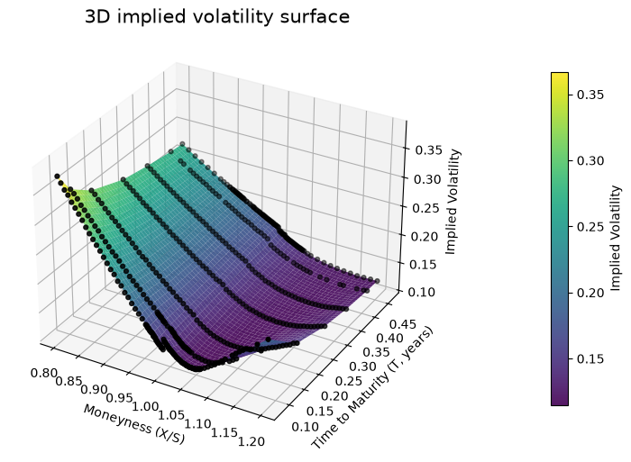
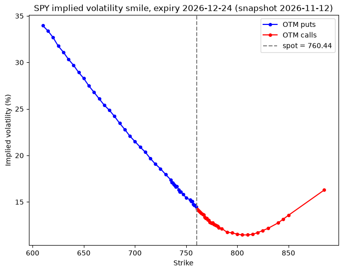
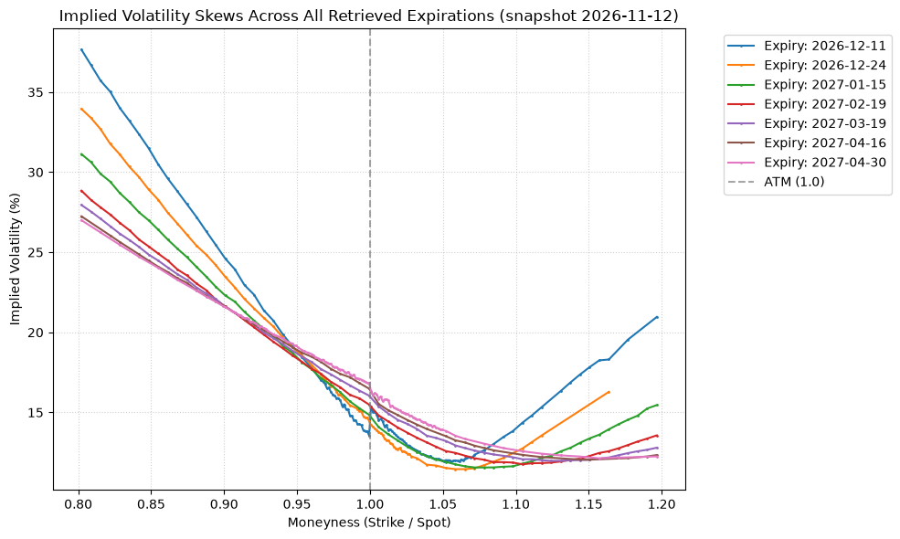

# An Investigation Into the Black-Scholes Model

## Investigating the assumption of constant volatility

The Black-Scholes pricing model for a European call option:

$$C = S\,N(d_1) - K e^{-rt}\,N(d_2)$$

where

$$d_1 = \frac{\ln\left(\frac{S}{K}\right) + \left(r + \frac{\sigma^2}{2}\right)t}{\sigma\sqrt{t}}, \qquad d_2 = d_1 - \sigma\sqrt{t}$$

and $N(\cdot)$ is the standard normal cumulative distribution function.

The Black-Scholes model allows us to set a price for an option based on these variables:

- Current stock price ($S$)
- Strike price ($K$)
- Time to expiry ($t$)
- Risk-free rate ($r$)
- Volatility ($\sigma$)

The formula takes volatility as a standalone value, independent of any other variables. The model therefore assumes that volatility remains constant when pricing an option. I chose to investigate this assumption by observing the relationship between an option's **implied volatility** and its strike price ($K$) and time to expiry ($t$).

The first four variables are set by the market, so if we already know the price of the option, we can substitute our values to get back the volatility of that option. This is the **implied volatility**.

I solved for the implied volatility of real SPY options from a market snapshot taken on 12 November 2026, across expiries from 29 days to about 6 months (169 days) after the snapshot. I used this to plot implied volatility against the 'moneyness' of an option (its strike divided by the spot price) and the time to expiry.

*Implied volatility surface for SPY options (snapshot 12 November 2026). Black points are observed values; the surface between expiries is linearly interpolated.*

The 3D surface shows how the implied volatility of an option varies with its strike price relative to the spot price, as well as with time to maturity. We will explore both of these relationships below.

## Is volatility constant across strikes?

### What the Black-Scholes model assumes

- A fixed volatility ($\sigma$) prices every option on a stock for every strike price
- The underlying stock's returns (log returns) follow a normal distribution

### How I tested it

**Hypothesis:** If we assume the assumption of constant $\sigma$ held, we would expect a horizontal straight line dictating one volatility for all options.

**Graph:** The figure shows implied volatility against strike for SPY options expiring 24 December 2026. It uses out-of-the-money puts below the spot and calls above it. We can see immediately that the curve is not flat.

### Observations

- The plot produces a 'skew'
- Implied volatility is highest for OTM put options, reaching 33.95% at a strike price of 610
- It falls steadily toward spot, reaching about 14% near-the-money
- Beyond spot, implied volatility continues to fall for OTM calls until reaching a minimum of about 11.5% at a moneyness of about 1.06
- It then rises to about 16% at the highest strike of 885

### Interpretations

The plot implies that options with lower moneyness (those further out-of-the-money) have a higher implied volatility.

We know that the model also assumes that the log returns of the underlying asset are normally distributed, with a single fixed volatility. A normal distribution is symmetric, so under this assumption equally large rises and falls are equally likely.

However, the curve produced here is asymmetric, with implied volatility considerably higher at low strikes than at equally distant high strikes. This is inconsistent with the normal distribution assumption and suggests option prices reflect a different distribution of outcomes.

To further investigate this assumption, we will compare SPY's historic returns with a normal distribution, testing whether features suggested by the option prices also appear in past data.

## Is volatility constant across expiries?

### What the Black-Scholes model assumes

- A fixed volatility ($\sigma$) prices every option on a stock for every expiry date

### How I tested it

**Hypothesis:** If we assume the assumption of constant $\sigma$ held, we would expect the same implied volatility for every expiry. On a graph of implied volatility against moneyness (strike divided by spot), the curves for each expiry would stack on top of each other and appear as one.

**Graph:** The figure shows implied volatility against moneyness (strike/spot) for 7 expiries ranging in time to maturity from about 1 to about 6 months. It uses out-of-the-money puts below the spot and calls above it. We can see immediately that the multiple curves, overlaid by expiry, do not align as one.

### Observations

- Every expiry shows the same downward skew as the single-expiry plot
- The skew is steepest for the shortest expiries and gradually becomes flatter for longer expiries. At moneyness 0.8, implied volatility is about 38% for the 29-day expiry, against about 27% for the 169-day expiry
- Between moneyness 0.8 and 1.0, implied volatility falls by about 24 percentage points at 29 days but only about 10 percentage points at 169 days
- On the call side, short expiries rise much more steeply, with about 21% at moneyness 1.2 for 29 days and about 12% for 169 days
- The longer-dated curves are much flatter overall, though none becomes a horizontal line

### Interpretations

The figure implies that options with a shorter time to maturity have higher implied volatilities when further out-of-the-money and lower implied volatilities when near-the-money, compared with longer-dated options. Implied volatility varies much more across strikes for shorter-dated options than for longer-dated ones.

## Data and method notes

- **Data:** SPY option chain from Yahoo Finance (via `yfinance`), a single snapshot taken on 12 November 2026 (spot 760.44)
- **Prices:** mid price, (bid + ask) / 2; only out-of-the-money options with a non-zero bid, within moneyness 0.8 to 1.2
- **Risk-free rate:** 4.244% (US 3-month Treasury yield, 12 November 2026)
- **Implied volatility:** solved by bisection using my own Black-Scholes pricer

## Limitations

- This is a single-day snapshot using mid prices, so the results describe one moment in the market.
- The 1-week expiry (19 November 2026) was excluded. Put-call parity on its quotes implied a forward about $1.70 above the one implied by spot, most likely because spot and option quotes were captured at slightly different times. Short maturities are the most sensitive to this, and longer expiries may be affected to a smaller degree, which could explain small irregularities near moneyness 1.0.
- SPY options are American-style, but Black-Scholes prices European options. Dividends are ignored and the risk-free rate is held constant.
- The surface between expiries is linearly interpolated, and long-dated strikes are sparse.

## Next

- Compare SPY's historical returns with a normal distribution (skewness, excess kurtosis and the frequency of extreme days) to test the distributional assumption directly.
